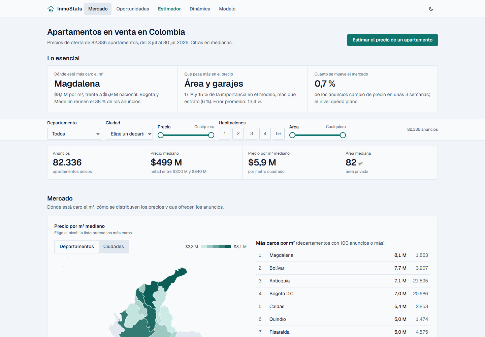

# 🏠 InmoStats

Sistema extremo a extremo de analítica y predicción de precios de vivienda
en Colombia: scraping nacional de `fincaraiz.com.co`, limpieza y feature
engineering, EDA con mapas reales y un modelo XGBoost que estima el precio
de un apartamento. El modelo se sirve con una API (FastAPI) y se explora
en un dashboard web (Next.js, desplegado en Vercel).

- 📊 **Dashboard:** <https://inmostats.vercel.app>
- ⚙️ **API (Hugging Face Spaces):** <https://huggingface.co/spaces/fchaparro/inmostats-api>



## Resultados del modelo

| Métrica (validación cruzada, 5 folds) | Valor |
|---|---|
| Modelo | XGBoost sobre `log(price_cop)` |
| Anuncios usados | 82.336 |
| MAPE | 13,41 % |
| R² | 0,8789 |

Detalle completo de la corrida vigente en `models/feature_config.json`
(ver [Fase 4](#fase-4-modelado)).

## Estructura

```text
inmostats/
├── data/
│   ├── raw/              # CSV crudos por corrida (los históricos están en git; los nuevos van a Hugging Face, ver Fase 3)
│   ├── processed/        # dataset limpio + stats_summary.json
│   └── reference/        # geojson de departamentos/municipios (geoBoundaries)
├── src/
│   ├── scraper/          # extracción de datos (fincaraiz_scraper.py)
│   ├── pipelines/        # limpieza, feature engineering, utilidades geo, dinámica del mercado, exportador web
│   ├── training/         # entrenamiento, tuning y evaluación del modelo
│   ├── api/               # servicio FastAPI que sirve el modelo
│   └── dashboard/         # dashboard anterior en Streamlit (el vigente es web/)
├── web/                   # dashboard web (Next.js para Vercel), ver web/README.md
├── docs/                  # imágenes del README (captura del dashboard)
├── notebooks/             # EDA (01_eda.ipynb)
├── models/                # modelo entrenado + config de features (no versionados)
├── scripts/                # utilidades puntuales (backfill, deploy_space.sh, scraper_ctl.sh)
├── workers/telegram-bot/    # bot de Telegram (Cloudflare Worker) para consultar progreso
├── .github/workflows/       # cron de GitHub Actions para el scraping periódico
└── requirements.txt
```

## Setup

```bash
python -m venv .venv
.venv\Scripts\activate        # Windows
pip install -r requirements.txt
```

> Nota: varias versiones fijadas originalmente en `requirements.txt`
> (scikit-learn, xgboost, joblib, fastapi, pydantic, streamlit) no tenían
> wheel prebuilt para Python 3.14 y fallaban al compilar desde código
> fuente en Windows. Si eso pasa, instala la versión más reciente del
> paquete en cuestión y actualiza el pin.

## Fase 1: Scraping nacional

Recorre las 14 zonas que fincaraiz reconoce a nivel nacional para
"apartamento en venta" (13 departamentos + el bucket "resto-de-colombia",
tomados directamente de su sitemap oficial, no adivinados) y guarda el
resultado crudo en `data/raw/`:

```bash
python -m src.scraper.fincaraiz_scraper
```

Puntos clave del diseño:
- **Cobertura real, sin cap**: cada zona se pagina hasta su última página
  real (el propio sitio embebe `lastPage`/`total` en cada respuesta), no
  hasta un número fijo. Algunas zonas grandes (Bogotá D.C., Antioquia,
  "resto de Colombia") tienen cientos o miles de páginas, así que una
  corrida completa puede tardar **varias horas**; es intencional, dado
  que se pidió cobertura exhaustiva en vez de una muestra acotada.
- **Resumible**: el progreso se guarda en `data/raw/.checkpoint_national.json`
  después de cada página. Si el proceso se interrumpe (Ctrl+C, corte de
  red, etc.), volver a correr el mismo comando continúa exactamente donde
  quedó en vez de reiniciar. Cuando una corrida termina por completo, la
  siguiente ejecución arranca una corrida nueva (nuevo CSV con timestamp).
- **Ejecución periódica e incremental**: cada corrida crea un CSV nuevo en
  `data/raw/` (nunca sobreescribe los anteriores; en GitHub Actions ese CSV se
  sube además a un dataset privado de Hugging Face, ver Fase 3). El pipeline de limpieza
  (fase 2) consolida todos los CSV y deduplica por `listing_id`, así que
  correr el scraper periódicamente solo *añade* anuncios nuevos a la base
  consolidada.
- Rota el User-Agent, reintenta hasta 3 veces ante fallos de red/timeout,
  y espera 2-4.5s entre peticiones para no saturar el sitio.
- **Los datos vienen del JSON estructurado que la página embebe para
  hidratación** (`script#__NEXT_DATA__` -> `fetchResult.searchFast`), no de
  raspar el HTML visible de la tarjeta. Esto da campos limpios y tipados
  y es más resistente a cambios de diseño del sitio.
- `department_real` guarda el departamento propio de cada anuncio
  (`locations.state`), independiente de la zona de búsqueda. Esto importa
  sobre todo para "resto-de-colombia", un bucket mixto que en la práctica
  trae anuncios de cualquier departamento.

Variables extraídas por anuncio: `listing_id`, `title`, `description`,
`address`, `detail_url`, `department`/`department_slug` (zona consultada),
`department_real`, `city`, `neighborhood`, `locality`, `zone`,
`latitude`/`longitude`, `price_cop`, `admin_fee_cop`, `bedrooms`,
`bathrooms`, `area_m2`, `area_built_m2`, `stratum`, `floor`,
`floors_count`, `antiquity`, `construction_year`, `garages`, `amenities`,
`is_new_project`, `owner_type`/`owner_name`, `image_count`,
`main_image_url`, `listing_created_at`/`listing_updated_at`,
`source_page`, `scraped_at`.

## Fase 2: Limpieza y feature engineering

Consolida todos los CSV crudos, deduplica por `listing_id`, descarta
outliers de dominio y agrega features derivadas:

```bash
python -m src.pipelines.clean_data
```

Filtros de limpieza (`clean()`): rango válido de precio y área, máximo de
habitaciones/baños, estrato fuera de 1-6, y `floor`/`garages` fuera de un
rango plausible (algunos anuncios traen valores imposibles como piso 812 o
127 garajes, que sin filtrar desestabilizan modelos lineales).

Features agregadas (`engineer_features()`):
- `price_per_m2`: precio de venta dividido por área.
- `department_final`: departamento real del anuncio (`department_real`
  cuando existe, normalizado a nombre canónico) con fallback a inferencia
  por ciudad (`infer_department_from_city`, usando la moda del propio
  dataset) para los anuncios de "resto-de-colombia" sin dato real.

Genera `data/processed/apartamentos_colombia_processed.csv`.

## Fase 3: Automatización (GitHub Actions + Telegram)

El scraping nacional corre solo, sin depender de que una máquina local
esté prendida:

- **`.github/workflows/scrape.yml`**: cron cada 30 minutos (más
  `workflow_dispatch` manual). Cada corrida scrapea un tramo acotado
  (`MAX_RUNTIME_SECONDS`), sube los CSV nuevos a un dataset privado de
  Hugging Face y solo el checkpoint a git (con reintento automático si otro
  push se adelantó), y respeta un
  cooldown de 24h entre corridas completas (`MIN_HOURS_BETWEEN_RUNS`) para
  no re-scrapear el sitio completo todos los días sin necesidad.
  > Estado actual: el workflow está **desactivado manualmente** en GitHub
  > (el dataset ya superó los 82.000 anuncios). Se controla con
  > `bash scripts/scraper_ctl.sh status|start|stop`: `status` muestra el
  > estado del workflow, los secrets y el checkpoint del repo; `start` y
  > `stop` piden confirmación antes de activar o desactivar el cron. Una
  > corrida completa tarda varios días y genera unos 235 MB de CSV. Al
  > terminar el recorrido completo, el propio workflow se desactiva y avisa
  > por Telegram.
- **`.github/workflows/stats.yml`**: una vez al día agrega al consolidado
  (Parquet en el mismo dataset de Hugging Face) los CSV nuevos y recalcula
  `data/processed/stats_summary.json` leyendo con DuckDB solo las columnas
  necesarias, sin descargar todos los CSV.
- **Notificaciones por Telegram**: inicio de una corrida nueva, resumen al
  terminar (duración total, anuncios nuevos), progreso porcentual, y
  alerta si el workflow falla.
- **`workers/telegram-bot/`**: bot interactivo (Cloudflare Worker, sin
  servidor propio) que responde a `/status` (progreso del scraping),
  `/stats` (promedios y anuncios por zona, calculados por
  `src/pipelines/compute_stats.py` en `data/processed/stats_summary.json`),
  `/variables` (qué campos se están extrayendo) y `/modelo` (resumen del
  modelo: métricas de validación cruzada, parámetros clave y variables más
  influyentes, leídos del `feature_config.json` del repositorio de modelo
  `fchaparro/inmostats-model` en Hugging Face). El estado del scraper y las
  estadísticas se leen del repo con un token de solo lectura (API de GitHub),
  así que funciona también si el repositorio es privado.

## Fase 4: Modelado

```bash
python -m src.training.train_baseline   # entrena, evalúa y guarda el modelo
python -m src.training.tune_xgboost     # búsqueda de hiperparámetros (lento, aparte)
```

Compara `LinearRegression` (baseline simple), `RandomForest` y `XGBoost`
sobre `log(price_cop)` (la distribución de precio viene sesgada a la
derecha), reportando métricas de vuelta en COP. Se prefiere XGBoost salvo
que otro modelo sea claramente mejor (>10% menos RMSE): a igual precisión,
el archivo serializado es ~100x más chico que el de RandomForest.

**Features**: numéricas (área, habitaciones, baños, estrato, piso,
antigüedad, garajes, lat/lon), categóricas de baja cardinalidad
(`department_final`, `owner_type`, one-hot) y de alta cardinalidad
(`city`, `neighborhood`, target encoding), flags binarios de las 15
amenidades más frecuentes, y flags de palabras clave de lujo/acabados
detectadas en el texto libre del anuncio (`title`/`description`), por ejemplo
"penthouse", "chimenea", "techos altos", elegidas comparando qué palabras
son más frecuentes en el cuartil de precio más caro que en el más barato.

**Evaluación**: split 80/20 más validación cruzada 5-fold (para no
depender de qué partición aleatoria tocó), y desglose de error por
cuartil de precio y por departamento (un MAPE agregado puede esconder
sesgos sistemáticos en un segmento específico).

**Resultado actual** (ver `models/feature_config.json` para el detalle
exacto de la corrida vigente): XGBoost, MAPE ≈ 13,41 %, R² ≈ 0,879 en CV
sobre 82.336 anuncios. El modelo subestima sistemáticamente el segmento de
lujo (cuartil más caro) y sobreestima el más barato. Se investigó con
sample weighting, recalibración isotónica y features de texto; la mejora
real vino de agregar `neighborhood` como feature, no de esas técnicas. El
sesgo remanente es una limitación conocida y documentada, no un bug: es
consistente con entrenar sobre `log(precio)` con relativamente pocos
anuncios de lujo, y probablemente falta información que solo está en las
fotos (calidad real de acabados).

Guarda `models/price_model.joblib` (pipeline completo: preprocesamiento +
modelo) y `models/feature_config.json` (vocabulario de amenidades/keywords,
métricas, features usadas, hiperparámetros clave e importancia de las
variables más influyentes); ambos están en .gitignore y se regeneran
localmente.

## Fase 5: API

Sirve el modelo entrenado (`models/price_model.joblib`) vía FastAPI:

```bash
uvicorn src.api.main:app --reload
```

Documentación interactiva en `http://localhost:8000/docs`.

- `GET /health`: chequeo básico.
- `GET /model-info`: modelo activo, fecha de entrenamiento y métricas.
- `GET /amenities`: vocabulario de amenidades reconocidas por el modelo.
- `POST /predict`: recibe características de un apartamento (ver
  `src/api/schemas.py::ApartmentInput`) y devuelve el precio estimado.
  Reconstruye internamente las columnas `amenity_*`/`txt_*` que el
  pipeline espera a partir de `amenities` (lista) y `description` (texto
  libre), usando `models/feature_config.json` para saber cuáles buscar.

## Fase 6: Dashboard

El dashboard vigente es una app web (`web/`, Next.js): <https://inmostats.vercel.app>.
Una sola página con filtros globales (departamento, ciudad, precio,
habitaciones y área) y estas secciones:

- **Mercado**: mapa de precio por m² por departamento y ciudad, distribución
  de precios, estratos, ciudades con más anuncios, comodidades y comparación
  por tipo de anunciante.
- **Oportunidades**: gráfico de dispersión de todos los anuncios frente a la
  mediana de su zona o frente al precio que esperaba el modelo (predicciones
  fuera de muestra).
- **Estimador**: formulario que llama a la API del modelo.
- **Dinámica** y **Modelo**: rotación y cambios de precio entre capturas, y
  métricas de validación del modelo.

No tiene servidor propio: lee JSON estáticos que genera
`python -m src.pipelines.export_dashboard_data` (ver más abajo y
`web/README.md`).

### Versión anterior (Streamlit)

El primer dashboard, en Streamlit (`src/dashboard/app.py`), consumía la API y
los datos procesados. Se conserva en el repositorio como versión histórica y
fue reemplazado por el web:

```bash
streamlit run src/dashboard/app.py   # requiere la API (INMOSTATS_API_URL)
```

## Notebooks

`notebooks/01_eda.ipynb`: EDA completo: distribuciones de precio, análisis
por departamento/ciudad/estrato, correlaciones, mapas interactivos
(scatter y coropletas reales con `plotly`), regresión precio-vs-área por
departamento, heatmap departamento×estrato y análisis de amenidades.

`notebooks/02_dinamica_mercado.ipynb`: dinámica del mercado en el tiempo a
partir de las capturas repetidas de `data/raw/` (8 corridas de julio de
2026): rotación de anuncios (separando rotación real de cobertura incompleta
del scraper), frecuencia y tamaño de los cambios de precio de un mismo
anuncio y evolución del nivel de precios con los mismos anuncios. El cálculo
vive en `src/pipelines/market_dynamics.py`, que comparten el notebook y el
exportador del dashboard web, así que las cifras se recalculan solas con cada
corrida nueva.

### Datos del dashboard web

`python -m src.pipelines.export_dashboard_data` escribe en `web/public/data/`
los agregados del tablero (KPIs, histograma, mapas con geometrías
simplificadas, listas de departamento, ciudad y barrio, métricas del modelo y
dinámica del mercado) como JSON estáticos de unos 500 KB en total. Además
genera `points.bin.gz` (1,1 MB, todos los anuncios en formato columnar, con el
precio que esperaba el modelo fuera de muestra) y las direcciones de los
anuncios en 64 archivos, que el frontend usa para filtrar y para el gráfico de
oportunidades. Todo se versiona porque el frontend se construye desde GitHub y
no tiene el CSV procesado. Con `--skip-dynamics` se omite el recálculo de la
dinámica (unos 20 s); el resto de opciones está en `web/README.md`.

## Fase 7: Despliegue

- **API → Hugging Face Spaces** (tipo Docker). No requiere tarjeta de
  crédito, a diferencia de la mayoría de plataformas con "free tier"
  (Render, Railway). Como `models/*.joblib` y `feature_config.json` son
  gitignored a propósito, el `Dockerfile` de la raíz (`master`) entrena el
  modelo desde cero en el build, ya que `data/raw/*.csv` sí está
  versionado.
  El Space, sin embargo, **no se construye desde `master`** sino desde la
  rama `space-deploy`, que nunca se mergea a `master`: Hugging Face rechaza
  archivos de más de 10 MB por push (varios CSV de `data/raw/` los superan),
  así que esa rama solo lleva `src/`, su propio `Dockerfile` (que descarga
  el modelo ya entrenado del repositorio de modelo `fchaparro/inmostats-model` de Hugging Face en vez de
  entrenarlo) y un `README.md` con el bloque YAML que Hugging Face exige
  para configurar el Space. Por eso el README de `master` no lleva ese
  bloque.

  Para publicar la rama en el Space (remoto `space`, rama `main`):

  ```bash
  bash scripts/deploy_space.sh
  ```

  El script comprueba que el remoto `space` y la rama `space-deploy`
  existan y que no haya cambios sin confirmar, muestra los commits que se
  van a subir y pide escribir `si` antes de empujar. Nunca fuerza el push:
  si `space/main` tiene commits que `space-deploy` no incluye, aborta.
  Cada push dispara un rebuild del Space.
- **Dashboard → Vercel**, desde la carpeta `web/` (framework Next.js). Se
  construye en cada push a `master` con los JSON estáticos versionados en
  `web/public/data/`. El estimador llama a la API del Space desde el navegador
  (CORS habilitado en `src/api/main.py`). El dashboard anterior en Streamlit
  Community Cloud ya no es el principal.
